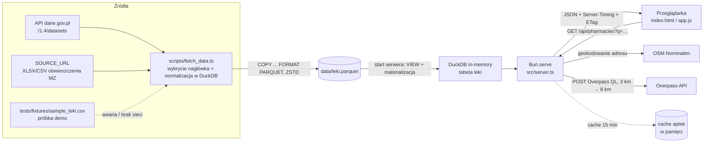

# Architektura i wydajność systemu TaniLek

## Metryka dokumentu (ISO 10013)

| Pole                          | Wartość                                              |
|-------------------------------|------------------------------------------------------|
| **Identyfikator dokumentu**   | DOC-ARCH-003                                         |
| **Tytuł**                     | Architektura i wydajność systemu TaniLek             |
| **Wersja**                    | 1.1.0                                                |
| **Autor**                     | Bartosz Pastuszka                                    |
| **Właściciel praw autorskich** | Bartosz Pastuszka                                  |
| **Data utworzenia**           | 2026-11-22                                           |
| **Data ostatniej aktualizacji** | 2026-11-22                                         |
| **Status**                    | Zatwierdzony                                         |
| **Klasyfikacja**              | Publiczny (licencja MIT)                             |
| **Dokumenty powiązane**       | DOC-ISO21513-001, DOC-PMI-LL-002, `README.md`        |

## Historia zmian

| Wersja | Data       | Autor                     | Opis zmian                    |
|--------|------------|---------------------------|-------------------------------|
| 1.0.0  | 2026-11-22 | Bartosz Pastuszka         | Pierwsze wydanie dokumentu.   |
| 1.1.0  | 2026-11-22 | Bartosz Pastuszka         | Moduł wyszukiwania aptek (`src/pharmacies.ts`, `GET /api/pharmacies`), `Cache-Control: no-cache` dla CSS/JS, `idleTimeout` 120 s, 189 testów. |

---

## 1. Cel i zakres dokumentu

Dokument opisuje architekturę aplikacji TaniLek, przepływ danych od źródła (dane.gov.pl /
obwieszczenie Ministra Zdrowia) do przeglądarki użytkownika, zastosowane techniki optymalizacji
wydajności oraz wyniki pomiarów. Jest przeznaczony dla programistów i opiekunów projektu.

## 2. Przegląd architektury

| Moduł                     | Odpowiedzialność                                                                 |
|---------------------------|----------------------------------------------------------------------------------|
| `src/config.ts`           | Odczyt i walidacja zmiennych środowiskowych; zamrożony obiekt konfiguracji.     |
| `src/aliases.ts`          | Słownik wyszukiwarki: 180 substancji czynnych i 1 154 aliasy (nazwy handlowe, polskie nazwy, opisy stosowania). |
| `src/types.ts`            | Typy domenowe: `DrugRecord`, `SearchResult`, `SavingsQuote`, `EquivalentsResult`. |
| `src/db.ts`               | Normalizacja źródeł do Parquet, samonaprawa danych, zapytania DuckDB, logika oszczędności. |
| `src/pharmacies.ts`       | Wyszukiwarka najbliższych aptek: Nominatim + Overpass API, Haversine, sortowanie, maks. 8 wyników, cache w pamięci (TTL 15 min), wstrzykiwalny `fetchFn`. |
| `src/server.ts`           | Serwer HTTP (`Bun.serve`), routing, walidacja parametrów, nagłówki HTTP, pliki statyczne. |
| `src/public/*`            | Interfejs bez frameworka i bundlera.                                             |
| `scripts/fetch_data.ts`   | Wyszukanie i pobranie wykazu, walidacja, zapis Parquet, tryb awaryjny.          |

## 3. Model danych

Plik `data/leki.parquet` ma stały, znormalizowany schemat niezależny od formatu źródła:

| Kolumna              | Typ      | Opis                                                             |
|----------------------|----------|------------------------------------------------------------------|
| `id`                 | INTEGER  | Kolejny numer pozycji.                                           |
| `nazwa`              | VARCHAR  | Nazwa handlowa.                                                  |
| `substancja_czynna`  | VARCHAR  | Substancja czynna (INN).                                         |
| `dawka`              | VARCHAR  | Moc, np. `20 mg`.                                                |
| `postac`             | VARCHAR  | Postać, np. `tabl. powl.`.                                       |
| `opakowanie`         | VARCHAR  | Zawartość opakowania, np. `30 szt.`.                             |
| `liczba_jednostek`   | INTEGER  | Liczba jednostek odczytana z `opakowanie` (NULL, gdy niejasna).  |
| `kod_ean`            | VARCHAR  | Kod EAN-13 (GTIN-14 z wiodącym zerem jest skracany).             |
| `poziom_odplatnosci` | VARCHAR  | `ryczałt`, `30%`, `50%`, `100%`, `bezpłatny`.                    |
| `doplata_pacjenta`   | DOUBLE   | Kwota płacona przez pacjenta (PLN).                              |
| `cena_detaliczna`    | DOUBLE   | Cena detaliczna brutto (PLN).                                    |
| `wskazanie`          | VARCHAR  | Zakres wskazań objętych refundacją.                              |

**Grupa zamienników** to pozycje o identycznym kluczu: znormalizowana substancja czynna (bez
wielkości liter i polskich znaków) + dawka (bez spacji, przecinek → kropka) + postać (bez
nadmiarowych spacji). Dzięki temu `Ramiprilum 5 mg tabl.` i `Ramiprilum 5 mg kaps. twarde`
**nie** są traktowane jako zamienniki – zamiana postaci wymaga decyzji lekarza.

## 4. Normalizacja źródła

Wykaz MZ nie ma stabilnego formatu między wydaniami, dlatego normalizacja nie zakłada
konkretnych nazw ani położenia kolumn:

1. Plik jest wczytywany bez nagłówka (`header = false, all_varchar = true`); XLSX przez
   rozszerzenie DuckDB `excel` z jawnym zakresem `A1:AZ1048576` – bez niego czytnik wnioskuje
   szerokość tabeli z pierwszego wiersza, którym w obwieszczeniu jest jednokomórkowy tytuł sekcji.
   CSV jest czytany z `parallel = false`, bo plik MZ zawiera wieloliniowe komórki, których
   równoległy czytnik nie dzieli poprawnie między wątki.
2. Usuwane są wiersze całkowicie puste (jawny zakres zwraca wszystkie ~1 mln wierszy arkusza).
3. W pierwszych 30 wierszach wyszukiwany jest wiersz nagłówka, w którym reguły
   `HEADER_RULES` rozpoznają wymagane kolumny (`nazwa`, `substancja_czynna`, `doplata_pacjenta`).
4. Kolumna „Nazwa, postać i dawka” jest dzielona na trzy pola (separatorem jest przecinek ze spacją,
   więc dawki z przecinkiem dziesiętnym, np. `0,03+0,15 mg`, pozostają nienaruszone); kwoty „12,50 zł” konwertowane
   do liczb; kody GTIN-14 skracane do EAN-13; liczba jednostek odczytywana z opakowania.
5. Wynik jest zapisywany do pliku tymczasowego, walidowany (minimalna liczba wierszy)
   i **atomowo** podmieniany (`rename`) – działający serwer nigdy nie odczyta połowy pliku.

Brak sieci, błąd HTTP, nieznana struktura lub zbyt mała liczba wierszy kończą próbę dla danego
zasobu; po wyczerpaniu kandydatów skrypt buduje bazę z próbki demo (tryb `--strict` zwraca wtedy
kod błędu). Serwer przy starcie sprawdza schemat pliku Parquet i w razie braku lub uszkodzenia
samodzielnie odtwarza go z próbki.

## 5. Techniki optymalizacji wydajności

### 5.1. Kolumnowy format Apache Parquet z kompresją ZSTD

Dane są przechowywane w formacie kolumnowym z kompresją ZSTD. Pomiar na wykazie MZ
(arkusz `A1` obwieszczenia z 16 września 2026 r., obowiązującego od 1 października 2026 r. – 4 282 leki):

| Postać danych                                   | Rozmiar    | Redukcja względem CSV |
|-------------------------------------------------|-----------:|----------------------:|
| Znormalizowany CSV (12 kolumn)                  | 887 766 B  | —                     |
| Oryginalny załącznik XLSX (17 kolumn)           | 901 384 B  | —                     |
| Parquet, kompresja Snappy                       | 157 763 B  | −82,2%                |
| **Parquet, kompresja ZSTD (stosowana)**         | **107 865 B** | **−87,9%**         |

Dla bardzo małych plików (próbka demo: 4 483 B CSV → 3 853 B Parquet) zysk jest niewielki,
bo dominuje stały narzut metadanych Parquet – korzyść rośnie z rozmiarem danych.
Format kolumnowy pozwala też czytać wyłącznie potrzebne kolumny (*projection pushdown*).

### 5.2. Widok nad Parquet i materializacja w pamięci przy starcie

Przy starcie serwer jednorazowo:

1. tworzy widok `leki_zrodlo` nad `read_parquet(...)` (z włączonym `parquet_metadata_cache`),
2. materializuje z niego kolumnową tabelę `leki` w pamięci DuckDB wraz z kolumnami
   wyliczonymi z góry: tekst do wyszukiwania bez polskich znaków (`_nazwa_f`, `_subst_f`,
   `_wsk_f`), klucz grupy (`_grupa`), liczba zamienników, najniższa dopłata w grupie
   i maksymalna możliwa oszczędność (z przeliczeniem opakowań).

Zapytanie użytkownika nie czyta więc dysku, nie parsuje nagłówków pliku i nie wykonuje
złączeń – to pojedynczy, filtrowany skan kolumnowy. Wersja pierwotna (sam widok nad Parquet
+ złączenie grupy przy każdym zapytaniu) była ok. 4× wolniejsza (tabela w p. 6).

### 5.3. Parametryzowane zapytania SQL, `ILIKE` i `LIMIT`

- Wszystkie wartości od użytkownika trafiają do SQL jako parametry przygotowanych zapytań
  (`$wzorzec`, `$prefiks`, `$surowy`, `$limit`, `$id`) – brak możliwości SQL injection.
- Przygotowane instrukcje są cache'owane per połączenie z puli (domyślnie 4 połączenia),
  więc SQL jest parsowany i planowany tylko raz.
- Filtrowanie odbywa się przez `ILIKE` na kolumnach wstępnie znormalizowanych (małe litery,
  bez diakrytyków). Znaki wieloznaczne `%`, `_` i `\` są usuwane z frazy przed zbudowaniem
  wzorca – fraza `%%` nie zwróci całej bazy.
- **Uwaga techniczna:** DuckDB nie korzysta z indeksów ART dla wzorców `ILIKE '%…%'`
  (z wiodącym symbolem wieloznacznym nie zrobi tego żaden indeks B-drzewa/ART). Szybkość
  zapewnia wektoryzowany skan kolumnowy danych w pamięci, a nie indeks; przy obecnej skali
  (kilka tysięcy pozycji) jest to rząd milisekund. Wyniki są ograniczane przez `LIMIT`
  (domyślnie 20, maks. 50 – konfigurowalne), a sortowanie premiuje dopasowanie prefiksu nazwy.

### 5.4. Nagłówki HTTP: `Server-Timing`, `ETag`, `Cache-Control`

| Nagłówek          | Zastosowanie                                                                    |
|-------------------|---------------------------------------------------------------------------------|
| `Server-Timing`   | `db;dur=…` – czas wykonania zapytania DuckDB (µs, `performance.now()`), `total;dur=…` – czas obsługi żądania. Interfejs wyświetla oba na żywo. |
| `ETag`            | Skrót treści (`Bun.hash`); dla zgodnego `If-None-Match` serwer zwraca `304 Not Modified` bez treści. |
| `Cache-Control`   | API: `public, max-age=60` (konfigurowalne `API_CACHE_MAX_AGE`); HTML, CSS i JS: `no-cache` + `ETag` (od 1.1.0; odwołania z `?v=1.1.0`, więc F5 zawsze pobiera aktualny interfejs, a niezmienione pliki kosztują tylko `304`); błędy i `/api/health`: `no-store`. |

### 5.5. Lekki frontend

- Trzy pliki statyczne (HTML 7,6 KB, CSS 19,6 KB, JS 25,3 KB) wczytywane do pamięci przy starcie
  serwera – brak operacji dyskowych na żądanie, brak bundlera i zależności po stronie klienta.
- Debouncing 150 ms i `AbortController` – podczas pisania wysyłane jest tylko ostatnie zapytanie,
  a nieaktualne odpowiedzi są anulowane.
- Dane wstawiane wyłącznie przez `textContent` (ochrona przed XSS), restrykcyjna polityka CSP.

### 5.6. Wyszukiwarka najbliższych aptek (od 1.1.0)

1. **Geokodowanie** – `GET https://nominatim.openstreetmap.org/search?format=jsonv2&countrycodes=pl&limit=1&q=…`
   z nagłówkami `User-Agent: TaniLek/1.1.0 (open-source pharmacy finder)` i `Accept-Language: pl`.
   Brak wyniku → `404` („Nie znaleziono podanego adresu ani kodu pocztowego w Polsce.”).
2. **Apteki** – `POST https://overpass-api.de/api/interpreter` z zapytaniem Overpass QL o
   `node["amenity"="pharmacy"]` i `way["amenity"="pharmacy"]` (`out center tags;`) w promieniu
   3000 m; przy pustym wyniku ponowienie z promieniem 8000 m.
3. **Przetwarzanie** – nazwa (`tags.name || "Apteka"`), adres z pól `addr:*`, `opening_hours`,
   `phone`, współrzędne (`lat`/`lon` lub `center` dla `way`); odległość wzorem Haversine'a,
   sortowanie rosnąco, maks. 8 wyników z linkiem `https://www.google.com/maps/dir/?api=1&destination=…`.
4. **Cache** – `Map` w pamięci z TTL 15 min (klucz: zapytanie bez różnic wielkości liter i spacji,
   maks. 500 wpisów); błędy nie są cache'owane.
5. **Odporność** – limit czasu 10 s (Nominatim) i 35 s (Overpass), `idleTimeout` serwera 120 s;
   błąd sieci, kod inny niż 2xx lub niepoprawny JSON → `502` z komunikatem po polsku.
6. **Frontend** – zapytania idą wyłącznie do własnego API (CSP `connect-src 'self'` bez zmian);
   ostatni adres w `localStorage` (`tanilek_location`).

## 6. Wyniki pomiarów

Środowisko: Windows 11 Pro, Bun 1.4.5, DuckDB 2.0.1 (`@duckdb/node-api`), dane rzeczywiste
(4 282 leki z arkusza `A1` obwieszczenia z 16.09.2026). Czasy z nagłówka `Server-Timing` / `performance.now()`, po rozgrzaniu
(pierwsze zapytanie zawiera przygotowanie instrukcji).

| Operacja                                         | Przed optymalizacją 5.2 | Po optymalizacji |
|--------------------------------------------------|------------------------:|-----------------:|
| Wyszukiwanie (`/api/search`), p50                | 12,7 ms                 | **3,1 ms**       |
| Wyszukiwanie, p95                                | 15,6 ms                 | **3,7 ms**       |
| Zamienniki (`/api/equivalents`), p50             | 6,9 ms                  | **1,5 ms**       |
| Zamienniki, p95                                  | 8,3 ms                  | **1,8 ms**       |
| Start bazy (walidacja + widok + materializacja)  | —                       | 67 ms            |
| Import XLSX → Parquet (`fetch-data`, z pobraniem) | —                      | ok. 1,1 s        |
| Pobranie strony / CSS / JS (localhost, curl)     | —                       | 4–5 ms każdy     |
| Apteki (`/api/pharmacies`), pierwsze zapytanie   | —                       | ok. 35 s (zależne od obciążenia publicznego Overpass API) |
| Apteki, powtórne zapytanie (cache w pamięci)      | —                       | **4,5 ms**       |

Na próbce demo (35 pozycji) czas zapytania DuckDB wynosi ok. 1–3 ms, przy czym większość tego
czasu stanowi stały narzut wywołania natywnego modułu, a nie samo przetwarzanie danych.

## 7. Bezpieczeństwo

- Konfiguracja wyłącznie przez zmienne środowiskowe z walidacją (`ConfigError` przy starcie).
- Parametryzowane zapytania; ścieżki plików w SQL pochodzą tylko z konfiguracji i są escapowane.
- Serwer udostępnia wyłącznie jawnie zadeklarowane pliki statyczne (brak *path traversal*).
- Nagłówki: `Content-Security-Policy`, `X-Content-Type-Options: nosniff`, `X-Frame-Options: DENY`,
  `Referrer-Policy: no-referrer`.
- Kontener działa jako użytkownik `bun` (bez uprawnień root), z `no-new-privileges`.
- Skrypt pobierania ogranicza rozmiar pliku (300 MB) i czas żądań (`FETCH_TIMEOUT_MS`).

## 8. Ograniczenia znane w wersji 1.1.0

1. Aktualny wykaz MZ **nie jest publikowany na dane.gov.pl** w formie tabelarycznej
   (stan na 2026-11-22: dostępny jest zbiór NFZ „Leki refundowane” z zestawieniami z lat
   2011–2018). Pełne dane są pobierane automatycznie z arkusza `A1` załącznika XLSX najnowszego
   obwieszczenia na gov.pl (lub z pliku wskazanego w `SOURCE_URL`); przy niepowodzeniu – próbka demo.
2. Dopłata pochodzi z kolumny „Wysokość dopłaty świadczeniobiorcy” dla podstawowego poziomu
   odpłatności; uprawnienia dodatkowe (np. leki bezpłatne dla seniorów „S”) nie są uwzględniane.
3. Liczba jednostek nie jest rozpoznawana dla ok. 9,6% pozycji (np. opakowania płynów
   „1 but. 100 ml”) – dla nich porównanie odbywa się na poziomie opakowania.
4. Jedno źródło danych na instancję; brak historii cen między wydaniami obwieszczenia.
5. Wyszukiwarka aptek zależy od publicznych serwerów OpenStreetMap: Overpass API bywa przeciążone
   (odpowiedź do ~30 s lub okresowo `502`/`406`), a dane OSM nie zawsze zawierają adres i godziny
   otwarcia. Odległość jest liczona w linii prostej, nie wzdłuż dróg.
